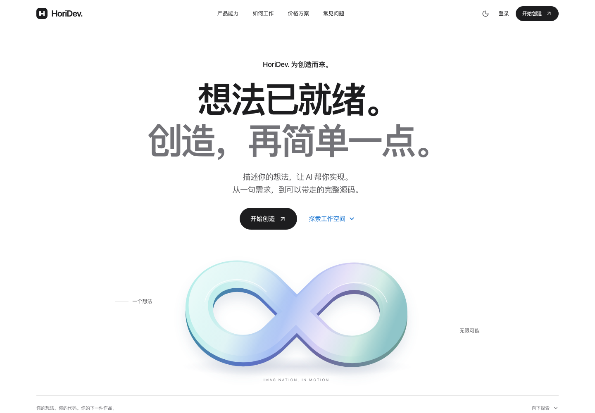

# HoriDev

**描述你的想法，让 AI 帮你实现。**

HoriDev — AI-Powered Software Development，是一套可以在本地运行、部署到 Cloudflare Workers 的 AI 软件交付 MVP。React 工作区、Hono API、Better Auth 身份认证、D1 数据和官方 OpenAI Responses 客户端均已实现。首版交付源码与 AI 静态审查，不执行任何客户或模型生成的程序。

源码仓库：[hhhoratioxu/HoriDev](https://github.com/hhhoratioxu/HoriDev)。仓库公开源码和本地验收记录，不包含 API 密钥、账号数据库或云端部署。



## 品牌界面

首页采用大字号、黑白灰、通栏产品展示与原创环形视觉，参考 Apple 产品官网的展示节奏和 OpenAI 的简洁排版。工作台、编程区、认证与管理后台共用同一套中性色和字体尺度，支持深浅模式、手机导航和减少动态效果。

视觉主题集中在 `src/brand.css`，原创矢量主视觉位于 `src/components/BrandSculpture.tsx`；没有使用 Apple 或 OpenAI 的 Logo、专有图片或付费字体。

## 快速开始

需要 Node.js 22.12+（推荐 24 LTS）、pnpm 11 和 Git。`./horidev` 启动器优先使用系统安装的 Node.js 与 pnpm，也兼容开发机上的 Codex 运行环境。

```sh
git clone https://github.com/hhhoratioxu/HoriDev.git
cd HoriDev
./horidev install --frozen-lockfile
./horidev setup
./horidev dev
```

打开 <http://localhost:5173>。前端热更新使用 5173，API 在本地 8787，两者由 Vite 同域代理连接。停止终端进程即可停止开发环境。生产部署不需要这台 Mac 持续在线。

首次运行请自行注册账号，密码至少 12 位。没有预置公共账号。`.dev.vars` 中的已有 API 密钥不会被 setup 覆盖；setup 只补充缺少的本地配置并设置权限为 0600。该文件和本地 D1 状态均已被 Git 忽略。

也可以使用打包后的完整同域环境：

```sh
./horidev build
./horidev preview
# 打开 http://localhost:8787
```

## 已实现的业务流程

1. 使用 Better Auth 注册、登录、退出，编辑个人资料、修改密码并撤销其他会话。
2. 创建私有项目与开发任务，提交真实需求文本，或导入现有源码文件。
3. 需求分析形成结构化方案；用户确认范围版本后才能生成代码。
4. 模型返回结构化多文件结果，验证路径、格式、大小后原子保存文件。
5. Monaco 工作区支持多标签、编辑保存、历史版本、恢复为新版本、Diff、受限制的 HTML 静态预览、单文件下载和 ZIP 导出。
6. 单独发起 AI 静态审查，查看问题严重程度、需求覆盖和最终说明。测试与构建标签清晰显示“未启用”。
7. 流式传输、取消、超时、失败恢复、有限重试和任务调用次数限制。
8. 独立管理员权限及密码重新验证；查看统计、成本、额度、异常、订单与操作审计；管理预算、用户额度、套餐和维护开关。

## Demo 与 Live

默认 `AI_MODE=demo`，即使配置了 API 密钥也不会产生调用。演示使用预置的 Excel 日期分类示例，不针对任意需求生成新的软件；UI、任务日志和消耗记录均标注 Demo，Token 为未知/不适用，费用为零。演示同样经过真实认证、D1、任务状态、文件版本和导出接口。

Live 需要同时满足：

- 服务端配置有效 `OPENAI_API_KEY`；禁止添加任何 `VITE_` 前缀的密钥。
- `AI_MODE=live`、`LIVE_CALLS_ENABLED=true`，平台 AI 开关开启且未维护。
- 模型 ID 和价格已配置，预算及并发检查通过。
- 管理员在订单页人工确认报价与资源授权。分析、生成、审查均消耗真实资源，因此分析前也需要授权。
- 新任务必须在 Live 模式下创建。历史 Demo 任务不允许直接升级成真实调用。

用户确认范围不代表付款。首版没有支付网关；人工确认记录不会伪造付款成功。套餐为配置化服务目录，目录中的建议任务数不会自动授予账号额度。

默认经济模型 `gpt-6-luna`，复杂生成任务使用 `gpt-6.1-sol`。这些 ID 和价格核对于 2026-10-29 官方文档，经济模型已完成一次有授权的真实 Responses 调用验收，复杂模型尚未在本账号调用。模型名称通过环境变量更改，价格通过管理员后台更改。[GPT-6 Luna](https://developers.openai.com/api/docs/models/gpt-6-luna)、[GPT-6.1 Sol](https://developers.openai.com/api/docs/models/gpt-6.1-sol)、[结构化输出](https://developers.openai.com/api/docs/guides/structured-outputs)、[流式 Responses](https://developers.openai.com/api/docs/guides/streaming-responses)。

应用只使用官方 Responses API，不接受用户提供的 API base URL，没有模型可调用的 shell、文件系统或网络工具。上下文在自有 D1 管理，`store:false`，每次最多最近 12 条任务消息和当前已保存文件；完整输入超过 60 KB 时明确拒绝，避免静默截断源码。

## 管理员初始化

先在本地注册你的账号，然后：

```sh
./horidev admin:grant your-email@example.com
```

重启开发服务，访问 `/admin`，再次输入该账号密码。管理会话有效期为 15 分钟，绑定当前登录会话。普通账号即使篡改前端或注册参数，也不能访问管理员 API。生产环境需将可信用户 ID 单独设置为 `ADMIN_USER_IDS` Secret；注册用户不能自封管理员。

## 工程结构

```text
HoriDev/
├── src/                    React 页面、设计系统、工作区与本地 Monaco
│   ├── pages/              首页、价格、认证、工作台、工作区、设置、管理员
│   ├── components/         公共 UI 与代码编辑器
│   ├── lib/                API、会话上下文、流式读取
│   └── i18n/               中文和英文的基础字典结构
├── worker/
│   ├── index.ts            Hono API、安全中间件与管理员接口
│   ├── db/schema.ts        Drizzle 数据模型
│   ├── lib/                认证、数据访问、文件安全与统一错误
│   └── services/           OpenAI、任务状态、演示适配器与预算账本
├── shared/contracts.ts     前后端类型与 Zod 结构
├── migrations/             D1 SQL 迁移与套餐/预算初始化
├── tests/                  单元、真实本地 D1 集成、SDK 模拟、浏览器测试
├── scripts/                本地初始化、管理员授权、部署保护
├── docs/                   部署、安全、成本、API 与验收说明
├── public/                 自有 Logo、静态资源安全响应头
├── .github/workflows/      CI 与手动生产部署入口
├── wrangler.jsonc          本地与生产 Workers/D1 配置
├── .dev.vars.example       服务端私有变量示例
└── horidev                 当前 Mac 可直接运行的 pnpm 启动器
```

数据库包含 users、sessions、accounts、verifications、projects、tasks、task_messages、generated_files、usage_records、pricing_plans、orders、platform_settings、user_quotas、task_events、rate_limits、admin_audit。

## 验证命令

```sh
./horidev typecheck
./horidev lint
./horidev format:check
./horidev test
./horidev build
./horidev test:e2e
```

单元与 API 测试只使用本地 Miniflare D1 和模拟模型，不读取 `.dev.vars` 或发送真实 API 请求。浏览器测试在本地 Workers 中跑 Demo 流程，不应切换为 Live。首次使用 Playwright 的其他设备可能需要 `./horidev exec playwright install chromium webkit`。

具体执行证据与边界见 [验收记录](docs/VERIFICATION.md)。依赖版本通过 `pnpm-lock.yaml` 固定；TypeScript 使用 6.0，避免当前 ESLint TypeScript 插件尚不支持 7.0 的兼容问题。Monaco 0.57 的导出路径已适配，并将全部资源打包到本站，不依赖公共 CDN。

## 部署与维护

- [Cloudflare D1、Secrets、R2 与 GitHub 部署步骤](docs/DEPLOYMENT.md)
- [安全设计与上线边界](docs/SECURITY.md)
- [内部预算、实际 usage 与费用估算](docs/COSTS.md)
- [API 与任务状态约定](docs/API.md)

生产配置保留不可部署的示例域名和 D1 ID；`./horidev deploy` 会先检查是否已替换，避免把开发配置误部署。源码发布到 GitHub 不会创建 Cloudflare 云端资源、购买服务或部署网站；生产部署工作流仅支持手动触发。

当前生产架构依赖 Cloudflare Workers 和 D1。在 Linux 服务器上使用 Node.js 与 pnpm 进行开发、构建或本地预览，与直接把它作为独立 Linux 生产服务运行是不同的部署方式；后者仍需要适配服务端运行时、数据库和持久化存储。详细配置见部署文档。

## 已知限制与商业化后续

- 未接入真实支付、邮件发送/找回/邮箱验证、Turnstile、MFA、订阅权益与企业协作。生产默认关闭公开注册；本地邮件仅作为账号标识。
- 未接入隔离执行平台。模型生成的软件、依赖与测试没有在 Workers 中执行；AI 静态审查可能漏报问题。
- 没有长时后台队列；一次阶段通过 SSE 连接处理，服务或连接中断后保留可恢复状态。超过 4 分钟的停滞任务可手动恢复，未知费用仍待核对。正式长任务应增加队列/Workflow 和隔离执行服务接口。
- 单用户最多 50 项目、200 任务；每个项目当前文件最多 20 个、单文件 100 KB、项目源码 500 KB、模型上下文 60 KB。首版列表为有界读取，未提供全量历史分页。
- 目前源码版本存于 D1。未配 R2 也可完整开发和导出；启用 R2 后将 ZIP 交付副本存入私有桶，D1 仍是版本与权限来源。
- 含真实费用记录的项目暂不允许直接删除，以保留核账依据；商业运营需要建立数据保留和隐私删除流程。
- 英文仅预留字典架构，界面还没有完整英文翻译。
- 内部预算无法替代 OpenAI 平台账单限制；新项目的账本也不包含此密钥在其他系统中的历史消耗。
- Worker 免费计划的 CPU 限制可能影响密码哈希和大型 ZIP；实际云端负载、账号地区和服务可用性需部署后验收，必要时在授权后使用付费计划。

一次真实 API 小预算验收已完成。建议下一阶段开展受邀用户试运行，再接入邮件验证、滥用防护、支付 webhook 的幂等状态机、完整审计/隐私流程，最后扩展长时任务和独立隔离执行服务。
